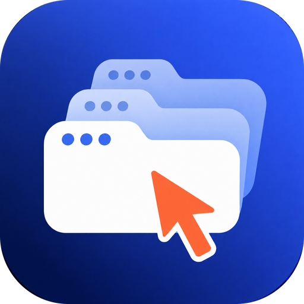
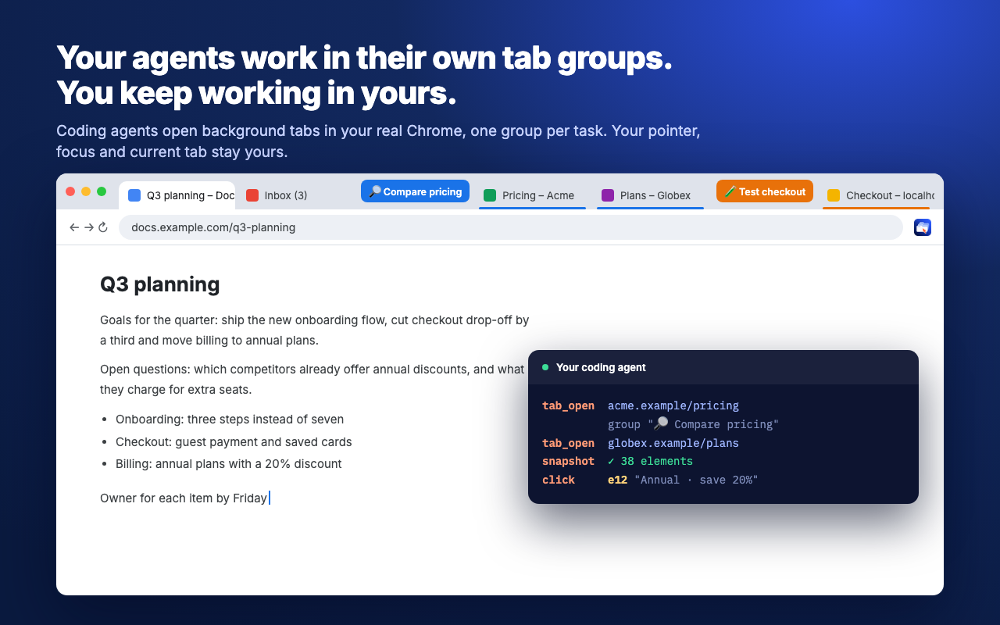
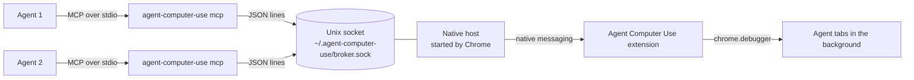
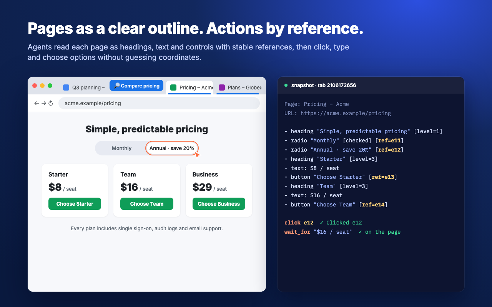
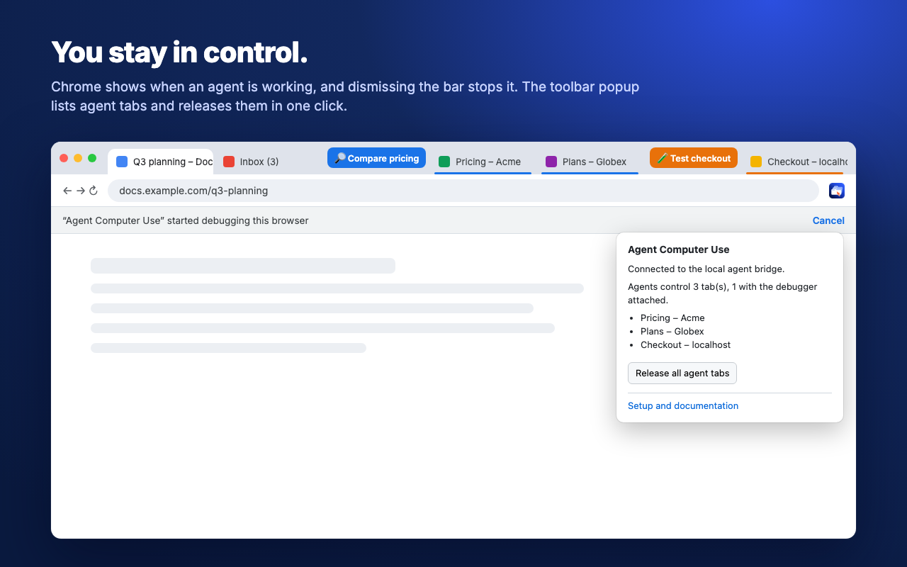

<p align="center"></p>

# Agent Computer Use

[npm](https://www.npmjs.com/package/@csltd/agent-computer-use) · [Privacy policy](PRIVACY.md) · [Chrome Web Store submission](docs/chrome-web-store.md) · [Issues](https://github.com/konstantinosbotonakis/agent-computer-use/issues)

Agent Computer Use lets local coding agents (Codex, Claude Code, Gemini CLI, Cursor, OpenCode, Copilot CLI and any other MCP client) work in your real Chrome while you keep using it. Each agent opens its own background tabs, grouped per task, and acts on them with its own pointer and keyboard. Your pointer, focus and current tab are not touched.

It works through a Chrome extension. Chrome's remote debugging stays off, so there is no "Allow remote debugging?" dialog and no permanent "Chrome is being controlled by automated test software" bar.



## Install

You need macOS or Linux, Chrome, Chromium, Brave or Edge 116 or later, and Node.js 20 or later.

```sh
npx @csltd/agent-computer-use install
```

`install` registers the native host for every Chromium-based browser it finds and copies the host and the extension to `~/.agent-computer-use`, so nothing depends on the npx cache.

Then:

1. Open `chrome://extensions`, turn on **Developer mode**, click **Load unpacked** and choose `~/.agent-computer-use/extension`. This step goes away once the extension is listed on the Chrome Web Store.
2. Add the MCP server to your agent (below).
3. Check the setup with `npx @csltd/agent-computer-use doctor`. Every line should say `ok`.

The extension cannot work on its own. Chrome only lets an extension talk to programs on your computer through a native messaging host, so the `install` step is always needed. A Chrome Web Store install has a different extension ID; register it with `npx @csltd/agent-computer-use install --extension-id <id>`.

After upgrading the package, run `install` again and reload the extension. `doctor` reports when the two versions differ.

## Add it to your agent

The MCP server is `npx -y @csltd/agent-computer-use mcp`. Use the full path to `npx` if your agent does not inherit your shell's `PATH`.

Codex (`~/.codex/config.toml`):

```toml
[mcp_servers.agent-computer-use]
command = "npx"
args = ["-y", "@csltd/agent-computer-use", "mcp"]
```

Claude Code:

```sh
claude mcp add -s user agent-computer-use -- npx -y @csltd/agent-computer-use mcp
```

Gemini CLI, Cursor, Windsurf, Kiro and most other clients (`mcpServers` JSON):

```json
{
  "mcpServers": {
    "agent-computer-use": {
      "command": "npx",
      "args": ["-y", "@csltd/agent-computer-use", "mcp"]
    }
  }
}
```

A short line in your agent instructions helps the agent pick the right tool, for example:

> For browser work, use the `agent-computer-use` MCP. Open tabs with `tab_open` and a short emoji-prefixed `group` name per task, read pages with `snapshot`, act with the `[ref=eN]` references it returns, and close your tabs with `tab_close` when done.

## How it works



- Chrome starts the native host when the extension loads. The host listens on a Unix socket that only your user account can open.
- Each agent runs `agent-computer-use mcp`, which connects to that socket and exposes browser tools.
- The extension opens agent tabs with `active: false`, puts them in a tab group named after the task, and forwards the agent's DevTools commands to those tabs through `chrome.debugger`.
- Clicks and key presses go straight to the page as DevTools input events. Pages see real, trusted events, and your pointer stays where it is.
- The extension detaches the debugger after two quiet minutes, so Chrome's "started debugging this browser" bar shows only while an agent is working. Dismissing that bar stops the agent on that tab.



## Tools

| Tool | What it does |
|---|---|
| `tabs_list` | Lists every open tab with its id, title, URL and group, and whether you control it |
| `tab_open` | Opens a URL in a new background tab inside a named tab group |
| `tab_claim` | Takes control of a tab you already have open, for when you ask an agent to work in it |
| `tab_close` | Closes a tab the agent controls |
| `navigate` | Loads a URL, or goes back, forward or reloads, and waits for the page |
| `snapshot` | Returns the page as an outline of headings, text, links and controls, with `[ref=eN]` references |
| `click`, `hover` | Clicks or hovers an element by reference |
| `type`, `press_key` | Types into a field, optionally replacing its value or pressing Enter; presses keys and shortcuts |
| `select_option` | Chooses options in a `<select>` |
| `scroll` | Scrolls an element into view or the page by screens |
| `screenshot` | Captures the viewport or the whole page, in PNG or JPEG |
| `evaluate` | Runs JavaScript in the page and returns the result |
| `console_messages`, `network_requests` | Console output, errors and requests since the agent attached |
| `wait_for` | Waits for text to appear or disappear, or for a number of seconds |
| `handle_dialog` | Accepts or dismisses alert, confirm and prompt dialogs |

Snapshots and element lookups run in an isolated script world, so the page's own scripts cannot see or change them.

## Mac apps (macOS)

On macOS the same MCP server also controls native apps through the Accessibility API. Agents read an app's windows as an outline of controls with `[ref=...]` references and act on them by reference, the same way they work with pages. The user's pointer does not move.

| Tool | What it does | Screen locked |
|---|---|---|
| `desktop_status` | Reports whether the screen is locked, the Accessibility and Screen Recording permissions, and keep-awake | works |
| `desktop_keep_awake` | Keeps the display and system awake, so the screen does not lock on idle, until turned off or logout | works |
| `desktop_apps` | Lists running apps with bundle id, process id and window titles | works |
| `desktop_open` | Opens an app, file or URL in the background | expected to work, not yet tested locked |
| `desktop_focus` | Brings an app to the front, for commands that act on the current selection | expected to work, not yet tested locked |
| `desktop_snapshot` | Returns an app's windows, and optionally its menu bar, as an outline with references | works |
| `desktop_action` | Presses a button or performs another accessibility action, such as ShowMenu or Increment | expected to work, not yet tested locked |
| `desktop_set_value` | Replaces the value of a text field or other editable element | expected to work, not yet tested locked |
| `desktop_menu` | Chooses a menu bar command by its titles, for example `["File", "New Window"]` | expected to work, not yet tested locked |
| `desktop_press_key` | Presses a key or shortcut; Cmd shortcuts run through the menu item that owns them | Cmd shortcuts expected to work, not yet tested locked |
| `desktop_type` | Types text into the app's focused element | no |
| `desktop_screenshot` | Captures an app's front window or the whole screen | no |

macOS keeps apps running behind the lock screen and answers Accessibility reads, but it does not deliver keyboard input and screen captures only show the lock screen. Actions and value changes use the same Accessibility calls as reads, but have not been tested on a locked screen yet. Turn on `desktop_keep_awake` before you leave the Mac so the screen does not lock in the first place.

The tools run a small Swift helper, `src/desktop-helper.swift`, which `install` or the first desktop tool call compiles into `~/.agent-computer-use/desktop`. Compiling needs the Xcode Command Line Tools (`xcode-select --install`).

macOS grants Accessibility and Screen Recording to the app that starts the agent (Codex, Claude, T3 Code, Terminal and so on), and the helper inherits them. If `desktop_status` reports `accessibility: false`, allow that app in System Settings > Privacy & Security > Accessibility, and for screenshots under Screen Recording, then restart it.

## Security

- Only this extension can start the native host: its manifest lists the extension's ID in `allowed_origins`.
- The socket lives in `~/.agent-computer-use` with mode `600`, so only processes running as your user can connect. Any such process can use the tools, which is the same trust level as your user account.
- An agent can only send commands to tabs it opened or claimed. `tab_claim` accepts any tab id, so tell your agents to claim a tab only when you ask.
- Agents can read and change everything in the tabs they control, including signed-in sessions. Keep that in mind before you point an agent at an account.
- On macOS, agents can read and operate every app the user can, through the permissions of the app that runs them.
- The extension's popup lists the tabs agents control and has a button to release them all.



## Privacy

Nothing is sent to the developer or any server. The extension passes page content and tab details only to the local program, which passes them to the agents you connect. See [PRIVACY.md](PRIVACY.md).

## Limitations

- Snapshots cover the main page and same-origin iframes. Cross-origin iframes are listed but not expanded.
- Chrome does not let extensions debug `chrome://` pages, the Chrome Web Store or other extensions' pages.
- Chrome slows timers and animations in background tabs.
- Mac apps built without accessibility support, such as some games and canvas-drawn apps, show few or no controls in `desktop_snapshot`.
- Menu commands and shortcuts that act on the current selection only work in the front app. Call `desktop_focus` first.
- Windows is not supported yet, because native host registration there needs the registry.

## Uninstall

```sh
npx @csltd/agent-computer-use uninstall
```

Then remove the extension at `chrome://extensions` and the MCP entry from your agents.

## Development

```sh
git clone https://github.com/konstantinosbotonakis/agent-computer-use.git
cd agent-computer-use
npm install
npm test
node bin/agent-computer-use.mjs install
```

Running `install` from a checkout prints MCP settings that point at the checkout. While developing, load the extension unpacked from the repository's `extension` folder so a reload picks up your changes.

- `npm run package:store` builds the Chrome Web Store upload in `dist/`.
- To release, set the same version in `package.json`, `package-lock.json` and `extension/manifest.json` (`npm version <x.y.z> --no-git-tag-version` updates the first two), push to `main`, then publish a GitHub release tagged `v<x.y.z>`. The [publish workflow](.github/workflows/publish.yml) checks the versions, runs the tests on macOS and publishes to npm through trusted publishing.
- `node scripts/render-store-images.mjs` renders the store screenshots and promo tile in `store/images` from the HTML in `store/`.
- [docs/chrome-web-store.md](docs/chrome-web-store.md) has the listing text, permission justifications and data disclosures.

## License

MIT. Built by Custom Services Limited.
